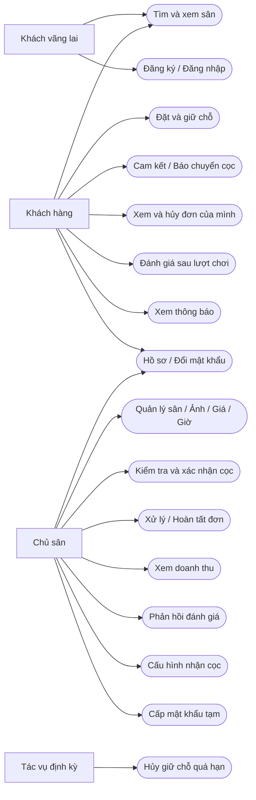
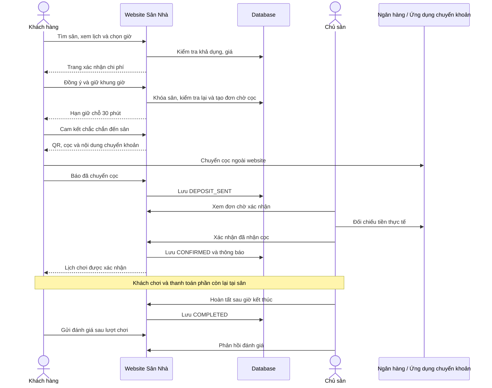
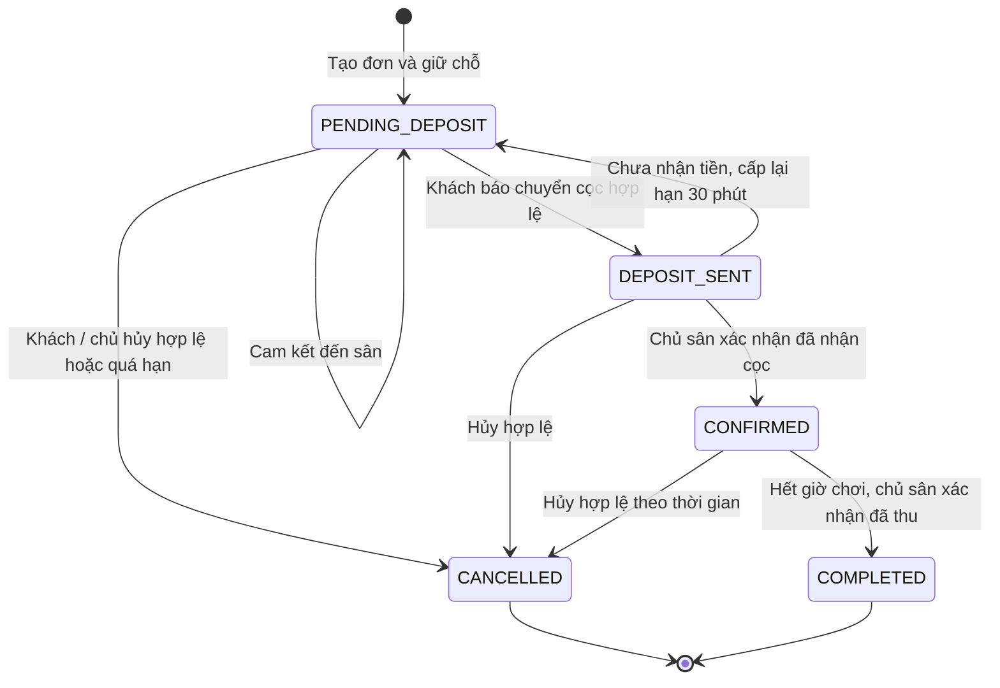
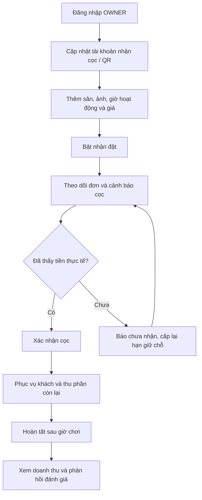
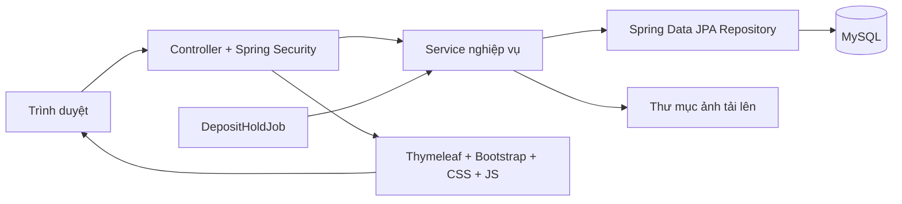
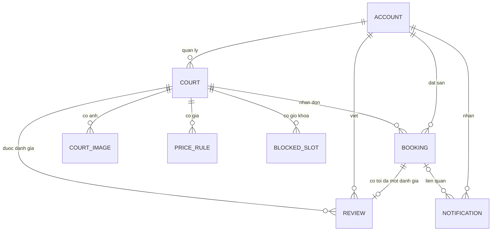

# BÁO CÁO CHỨC NĂNG, USE CASE VÀ LUỒNG HOẠT ĐỘNG — SÂN NHÀ

**Dự án:** Website đặt sân thể thao trực tuyến Sân Nhà
**Nhóm thực hiện:** Nhóm 2 — Đồ án HKDN
**Ngày tổng hợp:** 29/10/2026
**Cơ sở:** Controller, service, entity, repository, template và kết quả kiểm thử trong workspace hiện tại. Tài liệu mô tả chức năng đã có; phần định hướng phát triển được tách riêng.

## 1. Tổng quan và mục tiêu

Sân Nhà kết nối người có nhu cầu chơi thể thao với chủ sân. Khách có thể tìm sân, xem giá và lịch trống, giữ khung giờ, chuyển cọc, theo dõi đơn và đánh giá sau khi chơi. Chủ sân quản lý thông tin sân, giờ hoạt động, giá thuê, tiền cọc, đơn đặt và doanh thu.

Các vấn đề dự án giải quyết:

- Giảm việc hỏi lịch sân và ghi chép đơn thủ công.
- Cung cấp thông tin giá, ảnh, lịch trống và đánh giá tại một nơi.
- Hạn chế đặt trùng khung giờ và giữ chỗ không thanh toán kéo dài.
- Tách rõ trách nhiệm của khách khi chuyển cọc và của chủ sân khi xác nhận tiền.
- Theo dõi doanh thu và cọc đang giữ theo quy tắc thống nhất.

Phạm vi hiện tại gồm cầu lông, bóng đá, tennis và bóng rổ. Danh mục môn, khu vực là danh sách cấu hình sẵn trong code. Đơn vị đặt là **một sân, một ngày, một khung 60 phút, bắt đầu vào giờ tròn**.

## 2. Tác nhân và phân quyền

| Tác nhân | Mô tả | Phạm vi thao tác |
|---|---|---|
| Khách vãng lai | Chưa đăng nhập | Tìm sân, lọc, xem thông tin, ảnh, lịch và đánh giá; đăng ký, đăng nhập |
| Khách hàng — CUSTOMER | Tài khoản người đặt sân | Chức năng công khai, đặt sân, thao tác trên đơn của mình, thông báo, đánh giá, cập nhật số điện thoại và đổi mật khẩu |
| Chủ sân — OWNER | Tài khoản đã được cấp vai trò chủ sân | Quản lý sân của mình, khóa/mở giờ, xử lý cọc và đơn, xem doanh thu, phản hồi đánh giá, cấu hình nhận cọc, hỗ trợ mật khẩu tạm cho khách đủ điều kiện |
| Tác vụ định kỳ | Thành phần tự động trong ứng dụng | Kiểm tra đơn chờ cọc quá hạn và giải phóng khung giờ |
| Ngân hàng/ứng dụng chuyển khoản | Bên ngoài hệ thống | Người dùng chuyển tiền; chủ sân đối chiếu tiền thực tế ngoài hệ thống |
| Dịch vụ ảnh VietQR | Bên ngoài hệ thống | Cung cấp ảnh QR điền số tiền và nội dung theo thông tin tài khoản nhận cọc |

**Không có vai trò ADMIN hoặc màn hình quản trị toàn hệ thống trong phạm vi code hiện tại.** Form đăng ký chỉ tạo CUSTOMER; người dùng không tự đăng ký hay tự nâng quyền OWNER. Tài khoản OWNER không được dùng để đặt sân như CUSTOMER.

Ngân hàng không gửi callback xác nhận giao dịch cho ứng dụng hiện tại. Việc nhận tiền và hoàn tiền được chủ sân xử lý thủ công.

## 3. Danh mục chức năng

### 3.1. Tìm kiếm và thông tin sân

- Tìm theo tên sân, địa chỉ hoặc tên khu vực; lọc môn, khu vực, giá tối thiểu/tối đa.
- Kiểm tra khoảng giá hợp lệ; phân trang danh sách sân, giữ tham số tìm kiếm.
- Hiển thị số sân đang nhận đặt theo từng môn từ dữ liệu thật.
- Thẻ sân có ảnh nếu đã tải lên, tên, khu vực, địa chỉ, giá từ và thông tin đánh giá thực tế.
- Chi tiết sân gồm giới thiệu, tiện ích, ảnh, giờ mở/đóng cửa, giá mặc định và giá cao điểm.
- Xem ảnh phóng to, xem lịch theo ngày và giá theo từng giờ.
- Hiển thị trạng thái giờ: còn trống, đã đặt, đã khóa, đã qua giờ, ngừng nhận đặt.
- Xem đánh giá, điểm trung bình, số lượt đánh giá và phản hồi chủ sân.

### 3.2. Tài khoản và xác thực

- Đăng ký với họ tên, email, số điện thoại và mật khẩu.
- Kiểm tra email/số điện thoại không trùng; chuẩn hóa số điện thoại Việt Nam.
- Đăng nhập bằng email hoặc số điện thoại; đăng xuất.
- Xem hồ sơ, thay đổi số điện thoại, đổi mật khẩu bằng mật khẩu hiện tại.
- Chủ sân cấp mật khẩu tạm cho khách đã từng đặt sân của mình sau khi xác minh ngoài hệ thống.
- Người dùng mật khẩu tạm bắt buộc đổi mật khẩu trước khi tiếp tục sử dụng các trang nghiệp vụ.

### 3.3. Đặt sân, cọc và đơn đặt

- Chọn ngày/giờ, xem tóm tắt và chi phí trước khi tạo đơn.
- Kiểm tra lại khả dụng tại thời điểm gửi yêu cầu; chống đặt trùng.
- Lưu giá thuê vào đơn để thay đổi giá sân sau đó không làm thay đổi đơn cũ.
- Giữ chỗ 30 phút và tính cọc theo quy tắc 50%, làm tròn lên nghìn đồng.
- Khách xác nhận chắc chắn đến sân trước khi được xem phần QR chuyển cọc trên giao diện.
- QR ưu tiên ảnh chủ sân tải lên; nếu không có thì dùng VietQR từ tài khoản ngân hàng.
- Hiển thị tiền thuê, cọc, phần còn lại, thông tin nhận tiền và nội dung `SANNHA <mã đơn>`.
- Sao chép số tài khoản, số tiền và nội dung chuyển khoản.
- Khách báo đã chuyển; chủ sân kiểm tra và xác nhận hoặc báo chưa nhận.
- Xem lịch sử và chi tiết đơn theo quyền; hủy đơn theo quy định.
- Tự hủy đơn chờ cọc quá hạn, trả lại khung giờ và tạo thông báo.
- Chủ sân hoàn tất đơn sau khi lượt chơi kết thúc và đã thu tiền thực tế.

### 3.4. Chủ sân và doanh thu

- Dashboard với điều hướng tổng quan, sân, đơn đặt, doanh thu và thông tin nhận cọc.
- Thêm/sửa sân, bật/tắt nhận đặt, cấu hình giá và giờ hoạt động.
- Tải/xóa ảnh sân; tối đa 8 ảnh/sân, JPEG/PNG/WEBP, tối đa 10 MB/ảnh.
- Khóa/mở khung giờ tương lai chưa có đơn.
- Cập nhật ngân hàng nhận cọc hoặc tải/thay/xóa ảnh QR nhận tiền.
- Lọc đơn theo khoảng ngày chơi, sân và trạng thái.
- Đếm đơn khách báo chuyển cọc đang chờ chủ sân xác nhận.
- Thống kê tiền thuê hoàn tất, cọc giữ lại, cọc đang giữ, tổng tiền đã nhận và doanh thu theo sân.
- Phản hồi, sửa hoặc xóa phản hồi đánh giá về sân của mình.

### 3.5. Thông báo và trải nghiệm giao diện

- Thông báo trong ứng dụng khi xác nhận cọc, từ chối cọc, chủ sân hủy đơn, đơn hết hạn và khi có phản hồi mới lần đầu cho đánh giá.
- Số thông báo chưa đọc; hiển thị 10 thông báo gần nhất.
- Xem chi tiết đơn sẽ đánh dấu đã đọc các thông báo liên quan; có thao tác đánh dấu tất cả đã đọc.
- Header hiển thị theo quyền, menu tài khoản, footer Nhóm 2.
- Responsive, bảng đơn chuyển thành thẻ trên điện thoại; bộ lọc và điều hướng thu gọn.
- Trạng thái trống, lỗi, thành công, đang gửi; hạn chế gửi lặp tại giao diện.
- Focus bàn phím, nhãn form, icon SVG dùng chung, hỗ trợ giảm chuyển động.

## 4. Danh sách use case

| Mã | Use case | Tác nhân chính | Kết quả |
|---|---|---|---|
| UC01 | Đăng ký tài khoản | Khách vãng lai | Tạo CUSTOMER hợp lệ |
| UC02 | Đăng nhập/đăng xuất | Khách hàng, chủ sân | Tạo/kết thúc phiên đăng nhập |
| UC03 | Tìm kiếm và lọc sân | Mọi người dùng | Danh sách sân phù hợp và phân trang |
| UC04 | Xem sân, ảnh, lịch và đánh giá | Mọi người dùng | Có thông tin để lựa chọn sân/giờ |
| UC05 | Tạo đơn giữ chỗ | Khách hàng | Đơn PENDING_DEPOSIT, hạn giữ chỗ 30 phút |
| UC06 | Cam kết đến sân | Khách hàng | Lưu thời điểm cam kết; mở phần chuyển cọc trên giao diện |
| UC07 | Chuyển khoản và báo đã chuyển cọc | Khách hàng | Đơn DEPOSIT_SENT; chờ kiểm tra |
| UC08 | Xác nhận hoặc từ chối báo chuyển cọc | Chủ sân | CONFIRMED hoặc quay lại PENDING_DEPOSIT |
| UC09 | Xem lịch sử/chi tiết đơn | Khách hàng, chủ sân | Xem đúng đơn được cấp quyền |
| UC10 | Hủy đơn | Khách hàng, chủ sân | CANCELLED, giải phóng giờ, xử lý chính sách cọc |
| UC11 | Tự hủy đơn quá hạn | Tác vụ định kỳ | CANCELLED, giải phóng giờ, thông báo khách |
| UC12 | Hoàn tất lượt chơi | Chủ sân | COMPLETED, ghi nhận tiền thuê vào doanh thu |
| UC13 | Thêm/sửa thông tin sân | Chủ sân | Lưu thông tin, giá, giờ và trạng thái nhận đặt |
| UC14 | Quản lý ảnh sân | Chủ sân | Tải/xóa ảnh hợp lệ của sân mình |
| UC15 | Khóa/mở giờ | Chủ sân | Khung giờ bị khóa hoặc nhận đặt lại |
| UC16 | Cấu hình nhận cọc | Chủ sân | Lưu tài khoản ngân hàng hoặc ảnh QR |
| UC17 | Xem dashboard và doanh thu | Chủ sân | Chỉ tiêu và danh sách theo dữ liệu thuộc chủ sân |
| UC18 | Xem/đánh dấu thông báo | Khách hàng | Theo dõi cập nhật và trạng thái đã đọc |
| UC19 | Gửi/cập nhật đánh giá | Khách hàng | Một đánh giá gắn với một đơn đã hoàn tất |
| UC20 | Phản hồi đánh giá | Chủ sân | Lưu/sửa/xóa phản hồi thuộc sân mình |
| UC21 | Xem hồ sơ/cập nhật số điện thoại | Người đã đăng nhập | Thông tin liên hệ được cập nhật hợp lệ |
| UC22 | Đổi mật khẩu | Người đã đăng nhập | Mật khẩu mới được băm và lưu |
| UC23 | Hỗ trợ quên mật khẩu bằng mật khẩu tạm | Chủ sân, khách hàng | Cấp mật khẩu tạm và buộc đổi ngay khi đăng nhập |

### Sơ đồ phạm vi use case tổng quát

Sơ đồ dưới đây nhóm các use case để trình bày trên slide; danh mục đầy đủ nằm ở bảng trên.

## 5. Đặc tả use case và luồng xử lý

### UC01–UC02. Đăng ký và đăng nhập

**Tiền điều kiện:** Người dùng truy cập website; đăng ký cần email và số di động chưa sử dụng.

**Luồng chính:**

1. Người dùng nhập họ tên, email, số điện thoại, mật khẩu.
2. Hệ thống kiểm tra trường bắt buộc, định dạng và độ dài.
3. Email được chuyển về chữ thường; số điện thoại được chuẩn hóa về dạng 10 số bắt đầu bằng 0.
4. Kiểm tra trùng email/số điện thoại, băm mật khẩu BCrypt và tạo vai trò CUSTOMER.
5. Chuyển đến trang đăng nhập.
6. Người dùng nhập email hoặc số điện thoại cùng mật khẩu.
7. Spring Security xác thực và tạo phiên; định danh trong phiên luôn là email.
8. Nếu tài khoản dùng mật khẩu tạm, chuyển đến trang bắt buộc đổi mật khẩu; nếu không, về trang chủ.

**Ngoại lệ:** Thiếu trường, số điện thoại không hợp lệ, email/số điện thoại trùng, thông tin đăng nhập sai. Hệ thống hiển thị lỗi và không hoàn thành thao tác.

**Đăng xuất:** Người dùng gửi form đăng xuất, phiên đăng nhập được kết thúc và chuyển về trang chủ.

### UC03–UC04. Tìm sân và xem chi tiết

**Tiền điều kiện:** Không bắt buộc đăng nhập.

1. Mở trang chủ, nhập từ khóa và các bộ lọc hiện có.
2. Hệ thống kiểm tra giá không âm và giá tối thiểu không lớn hơn giá tối đa.
3. Truy vấn danh sách sân đang nhận đặt; trả 8 sân/trang, kèm ảnh bìa và thống kê đánh giá. Bộ lọc giá áp dụng trên giá từ (`Court.minPrice`) của sân, không phải truy vấn mọi mức giá của mọi khung giờ.
4. Người dùng xem trang tiếp theo với bộ lọc được giữ lại.
5. Chọn sân, xem ảnh, tiện ích, giờ hoạt động, bảng giá và đánh giá.
6. Chọn ngày để xem lịch từng giờ và giá tương ứng.
7. Khách đã đăng nhập với vai trò CUSTOMER chọn khung giờ trống để tiếp tục đặt; khách chưa đăng nhập được dẫn đến đăng nhập.

**Ngoại lệ:** Không có sân phù hợp thì hiển thị trạng thái trống; ngày ngoài phạm vi thì báo lỗi; sân không tồn tại thì báo không tìm thấy. Xem thông tin trên trang chưa đồng nghĩa đã giữ khung giờ.

### UC05. Tạo đơn giữ chỗ

**Tác nhân:** CUSTOMER.
**Tiền điều kiện:** Đã đăng nhập, có số điện thoại, sân nhận đặt, khung giờ tương lai hợp lệ và chưa bị chiếm/khóa.

1. Chọn một giờ trống và mở trang xác nhận.
2. Kiểm tra tên sân, ngày, giờ, tổng tiền, tiền cọc và phần còn lại.
3. Đồng ý chính sách và bấm giữ khung giờ.
4. Hệ thống kiểm tra quyền, số điện thoại và khóa bản ghi sân trong giao dịch.
5. Nếu khung giờ có đơn chờ cọc đã hết hạn, xử lý giải phóng đơn đó trước.
6. Kiểm tra lại khả dụng; không chỉ dựa vào trạng thái đã hiển thị trước đó.
7. Lưu đơn, giá tại thời điểm đặt, số tiền cọc, khóa khung giờ đang hoạt động và hạn giữ chỗ.
8. Đặt trạng thái PENDING_DEPOSIT; chuyển người dùng đến chi tiết đơn.

**Hậu điều kiện:** Khung giờ được giữ tối đa 30 phút nếu chưa báo chuyển cọc.

**Ngoại lệ:** Người khác vừa đặt, giờ bị khóa, sân dừng nhận đặt, giờ đã bắt đầu, ngày không hợp lệ hoặc thiếu số điện thoại. Không tạo thêm đơn hợp lệ cho cùng khung giờ.

### UC06–UC07. Cam kết và báo chuyển cọc

**Tiền điều kiện:** Đơn của chính khách, còn PENDING_DEPOSIT, chưa quá hạn và chưa bắt đầu giờ chơi.

1. Khách đọc chính sách, tích đồng ý và xác nhận chắc chắn đến sân.
2. Hệ thống lưu `committedAt`.
3. Giao diện hiển thị QR nếu chủ sân có thông tin nhận tiền.
4. Khách đối chiếu người nhận, cọc, nội dung và thực hiện chuyển khoản ngoài ứng dụng.
5. Với QR tải lên, khách tự nhập số tiền/nội dung theo hướng dẫn; với VietQR, ảnh QR điền sẵn các thông tin tương ứng.
6. Khách bấm “Tôi đã chuyển khoản cọc”.
7. Hệ thống kiểm tra lại chủ sở hữu đơn, cam kết, khả năng nhận cọc, hạn giữ chỗ và giờ bắt đầu.
8. Lưu `depositSentAt`, chuyển DEPOSIT_SENT.

**Hậu điều kiện:** Chủ sân thấy đơn chờ xác nhận. Đơn chưa được công nhận đã nhận tiền.

**Ngoại lệ:** Chưa cam kết, thiếu thông tin nhận cọc, hết hạn hoặc đơn đã chuyển trạng thái thì không cho báo chuyển. QR không tải được có thông báo để dùng thông tin chuyển khoản hoặc liên hệ chủ sân.

### UC08. Chủ sân xác nhận hoặc báo chưa nhận cọc

**Tiền điều kiện:** OWNER quản lý sân của đơn; đơn có báo chuyển cần kiểm tra.

1. Chủ sân mở dashboard hoặc chi tiết đơn chờ xác nhận.
2. Đối chiếu tài khoản/ứng dụng nhận tiền thực tế với số tiền và nội dung `SANNHA <mã đơn>`.
3. Nếu nhận đủ tiền, xác nhận “Đã nhận cọc”.
4. Hệ thống lưu `depositConfirmedAt`, chuyển DEPOSIT_SENT sang CONFIRMED và tạo thông báo cho khách.
5. Nếu chưa nhận tiền, chủ sân chọn “Chưa nhận được”.
6. Hệ thống đưa đơn về PENDING_DEPOSIT, xóa thời điểm báo chuyển và cấp hạn giữ chỗ mới 30 phút; khách được thông báo kiểm tra giao dịch.

**Trường hợp đặc biệt:** Khách đã báo chuyển rồi hủy, bị đánh dấu mất cọc nhưng chủ sân chưa kiểm tra: chủ sân vẫn có thể xác nhận tiền cọc để ghi nhận cọc giữ lại; đơn vẫn CANCELLED, không khôi phục lịch chơi.

### UC09. Xem lịch sử và chi tiết đơn

- Khách xem lịch sử đơn của mình, 10 đơn/trang, kèm giờ chơi, giá, cọc, trạng thái và hạn giữ chỗ nếu còn chờ cọc.
- Chủ sân xem danh sách các đơn thuộc sân của mình, lọc theo ngày chơi, sân, trạng thái và phân trang 10 đơn/trang.
- Chi tiết đơn hiển thị thao tác theo quyền và trạng thái; backend kiểm tra lại điều kiện khi thao tác.
- Không thể xem hoặc thay đổi đơn của người khác chỉ bằng cách sửa mã đơn trên URL.

### UC10. Hủy đơn

**Tiền điều kiện:** Đơn còn hoạt động; người thao tác là khách đặt đơn hoặc chủ sân tương ứng.

1. Người dùng mở đơn và chọn hủy.
2. Giao diện hiển thị xác nhận và chính sách liên quan đến cọc.
3. Backend kiểm tra quyền và thời gian.
4. Nếu là khách: giờ chơi phải còn **hơn 2 tiếng**; đúng 2 tiếng cũng không được hủy.
5. Nếu là chủ sân: phải hủy trước khi giờ chơi bắt đầu.
6. Chuyển CANCELLED và giải phóng khóa khung giờ.
7. Khách hủy sau khi đã báo chuyển cọc thì đánh dấu mất cọc; trước khi báo chuyển thì không đánh dấu mất cọc.
8. Nếu chủ sân hủy, tạo thông báo; trường hợp khách đã báo chuyển thì nhắc chủ sân hoàn cọc thủ công.

**Hậu điều kiện:** Khung giờ có thể được đặt lại nếu còn đáp ứng các điều kiện khác. Hệ thống không thực hiện chuyển tiền hoàn cọc tự động.

### UC11. Tự hủy giữ chỗ quá hạn

1. Tác vụ bắt đầu kiểm tra sau 30 giây kể từ khi ứng dụng khởi động, sau đó lặp với độ trễ 60 giây giữa các lượt.
2. Tìm đơn PENDING_DEPOSIT có `holdUntil` nhỏ hơn hoặc bằng thời gian máy chủ.
3. Khóa và đọc lại đơn để tránh xung đột với thao tác báo chuyển cọc đang diễn ra.
4. Nếu vẫn đủ điều kiện, chuyển CANCELLED và giải phóng giờ.
5. Tạo thông báo hết hạn cho khách.

Việc cập nhật tự hủy trên danh sách có thể chờ lượt tác vụ tiếp theo; không phải bộ đếm thời gian thực chính xác từng giây. Backend vẫn từ chối cam kết/báo cọc khi hết hạn và có cơ chế giải phóng đơn hết hạn khi người khác đặt lại cùng giờ. Đơn DEPOSIT_SENT không bị tác vụ này tự hủy theo hạn cọc ban đầu.

### UC12. Hoàn tất lượt chơi

**Tiền điều kiện:** Chủ sân đúng quyền; đơn CONFIRMED; đã qua thời điểm kết thúc khung 60 phút.

1. Khách đến sân, sử dụng sân và thanh toán phần còn lại ngoài ứng dụng.
2. Chủ sân chọn hoàn tất và xác nhận đã thu tiền.
3. Backend kiểm tra trạng thái, quyền và thời gian kết thúc.
4. Chuyển COMPLETED.
5. Báo cáo ghi nhận toàn bộ giá thuê của đơn; khách được quyền đánh giá.

Hệ thống kiểm tra thời gian và trạng thái, còn việc thu tiền được ghi nhận theo xác nhận thủ công của chủ sân. Chưa có đối soát giao dịch tự động.

### UC13–UC16. Quản lý sân, ảnh, lịch và thông tin nhận cọc

**Quản lý sân:** Chủ sân vào thêm/sửa sân, nhập tên, môn, khu vực, địa chỉ, tiện ích, mô tả, giá, giờ hoạt động và trạng thái nhận đặt. Backend kiểm tra vai trò và quyền sở hữu sân, dữ liệu form và tính hợp lệ của giờ. Giá mặc định và giá cao điểm trong phạm vi 1.000–10.000.000 đồng; giá cao điểm phải nhập đủ giờ bắt đầu, kết thúc và giá, đồng thời nằm trong giờ hoạt động.

Khi sửa giờ hoạt động, nếu giờ mới loại bỏ khung đang có đơn hoạt động từ hôm nay trở đi, hệ thống từ chối và yêu cầu xử lý đơn trước. Tắt nhận đặt không tự hủy các đơn đã tồn tại. Giá mới chỉ ảnh hưởng các lần đặt mới. Giao diện hiện tại không có chức năng xóa sân.

**Ảnh sân:** Chủ sân chọn ảnh và lưu form. Hệ thống kiểm tra định dạng thực, dung lượng, số lượng và lưu tệp với tên sinh tự động. Chủ sân có thể xóa từng ảnh của sân mình, có xác nhận trước thao tác. Tối đa 8 ảnh/sân, 10 MB/ảnh, JPEG/PNG/WEBP.

**Khóa/mở giờ:** Chủ sân mở lịch sân, chọn giờ tương lai. Nếu giờ còn trống thì khóa; nếu đã khóa thì mở lại. Không được khóa giờ đã có đơn, ngoài giờ hoạt động, đã bắt đầu hoặc thuộc sân người khác.

**Nhận cọc:** Chủ sân vào tài khoản, lựa chọn tải ảnh QR nhận tiền hoặc lưu ngân hàng, số tài khoản và tên chủ tài khoản. Nếu có cả hai, hệ thống ưu tiên ảnh QR tải lên. Kiểm tra ngân hàng thuộc danh sách hỗ trợ, số tài khoản 6–20 chữ số; tên được chuẩn hóa viết hoa không dấu. Không có OTP hoặc xác thực chủ sở hữu tài khoản ngân hàng tự động.

### UC17. Theo dõi dashboard và doanh thu

1. Chủ sân mở dashboard; mặc định khoảng thống kê từ đầu tháng đến hôm nay.
2. Chọn ngày bắt đầu/kết thúc, sân và trạng thái đơn.
3. Hệ thống kiểm tra khoảng ngày và quyền quản lý sân được chọn.
4. Trả danh sách đơn và báo cáo tiền theo quy tắc ở phần 8.
5. Chủ sân xem tổng quan, cảnh báo chờ xác nhận cọc và các khoản doanh thu theo sân.

Các chỉ tiêu có phạm vi khác nhau; không được mô tả tất cả đều phụ thuộc cùng bộ lọc ngày/trạng thái. Hệ thống hiện dùng thẻ chỉ tiêu, bảng và danh sách theo dữ liệu thật; chưa có chuỗi biểu đồ doanh thu từng ngày hay xuất báo cáo Excel/PDF.

### UC18. Xem và đánh dấu thông báo

1. Hệ thống phát sinh thông báo cho khách tại các sự kiện nghiệp vụ đã nêu.
2. Header hiển thị số thông báo chưa đọc.
3. Khách vào “Lịch của tôi”, xem tối đa 10 thông báo gần nhất.
4. Chọn thông báo để mở đơn; các thông báo liên quan đơn được đánh dấu đã đọc.
5. Hoặc chọn “Đánh dấu đã đọc tất cả”.

Thông báo hiện nằm trong website, chưa có gửi email, SMS, push hoặc cập nhật WebSocket thời gian thực. Cảnh báo số đơn chờ cọc của chủ sân là số đếm truy vấn từ đơn DEPOSIT_SENT, không phải thông báo ngân hàng.

### UC19–UC20. Đánh giá và phản hồi

**Khách đánh giá:** Mở đơn COMPLETED của mình, chọn 1–5 sao và nhận xét không bắt buộc tối đa 1.000 ký tự. Hệ thống kiểm tra quyền và trạng thái rồi lưu. Mỗi đơn có một đánh giá; gửi lại cập nhật đánh giá cũ. Điểm trung bình và số lượt đánh giá sân được tính từ dữ liệu đã lưu.

**Chủ sân phản hồi:** Mở đánh giá sân của mình, nhập phản hồi tối đa 1.000 ký tự và lưu. Có thể sửa; để trống rồi lưu để xóa phản hồi. Khi thêm phản hồi từ trạng thái chưa có phản hồi, hệ thống tạo thông báo cho khách; sửa một phản hồi đang tồn tại không tạo lại thông báo theo cùng điều kiện đó. Khách khác chỉ được đọc, không sửa đánh giá của người đặt đơn.

### UC21–UC22. Hồ sơ và đổi mật khẩu

**Hồ sơ:** Người dùng xem thông tin tài khoản, vai trò và cập nhật số điện thoại. Số mới phải hợp lệ, không trùng. Hiện không có form tự sửa họ tên/email hoặc thay đổi vai trò.

**Đổi mật khẩu:** Nhập mật khẩu hiện tại, mật khẩu mới và xác nhận. Hệ thống kiểm tra mật khẩu hiện tại, mật khẩu mới khác mật khẩu cũ, khớp xác nhận, dài 8–64 ký tự và không vượt giới hạn 72 byte UTF-8 của BCrypt. Lưu mật khẩu đã băm và bỏ yêu cầu đổi mật khẩu tạm nếu có.

### UC23. Hỗ trợ quên mật khẩu

1. Khách liên hệ chủ sân nơi mình đã từng đặt sân.
2. Chủ sân xác minh người gọi ngoài hệ thống, mở đơn của khách và chọn cấp mật khẩu tạm.
3. Backend kiểm tra OWNER, người nhận là CUSTOMER và có lịch sử đặt sân thuộc chủ sân đó.
4. Sinh mật khẩu tạm ngẫu nhiên, lưu dưới dạng băm, đánh dấu bắt buộc đổi mật khẩu.
5. Mật khẩu tạm hiển thị một lần trên giao diện chủ sân để cung cấp riêng cho khách; mật khẩu cũ bị thay thế.
6. Khách đăng nhập bằng mật khẩu tạm; interceptor chuyển đến trang đổi mật khẩu.
7. Khách đặt mật khẩu mới hợp lệ, sau đó tiếp tục sử dụng hệ thống.

Đây là cơ chế hỗ trợ thủ công, không phải khôi phục qua email/OTP. Code hiện tại chưa có thời hạn hết hiệu lực riêng cho mật khẩu tạm; không mô tả nó như OTP tự hết hạn.

## 6. Luồng hoạt động đầu cuối

### 6.1. Luồng đặt sân thành công

### 6.2. Sơ đồ trạng thái đơn

| Trạng thái | Ý nghĩa | Giữ khung giờ? | Hành động tiếp theo |
|---|---|---|---|
| PENDING_DEPOSIT | Chờ cọc, có thể đã cam kết hoặc chưa | Có, cho đến khi được giải phóng | Cam kết, chuyển và báo cọc trước hạn |
| DEPOSIT_SENT | Khách báo chuyển, chủ chưa xác nhận | Có | Chủ sân đối chiếu và xác nhận/từ chối |
| CONFIRMED | Chủ sân đã xác nhận cọc; có hỗ trợ đơn cũ không có cọc | Có | Đến chơi; chủ sân hoàn tất sau giờ kết thúc |
| COMPLETED | Lượt chơi được chủ sân xác nhận hoàn tất và thu tiền | Không thuộc nhóm trạng thái hoạt động | Khách gửi/cập nhật đánh giá |
| CANCELLED | Đơn bị hủy bởi khách, chủ sân hoặc tác vụ hết hạn | Không | Có thể đặt đơn khác nếu giờ vẫn khả dụng |

Cam kết chỉ lưu thêm thời điểm, không phải trạng thái thứ sáu. Hết hạn cũng dùng CANCELLED, không có trạng thái EXPIRED riêng. Khách hủy và chủ hủy đều dùng CANCELLED; chính sách cọc được thể hiện bằng dữ liệu bổ sung như `depositForfeited`.

### 6.3. Luồng vận hành của chủ sân

## 7. Quy tắc nghiệp vụ cần trình bày chính xác

| Mã | Quy tắc |
|---|---|
| BR01 | Mỗi đơn ứng với một sân, một ngày và một khung 60 phút bắt đầu giờ tròn |
| BR02 | Ngày xem/đặt trong khoảng hôm nay đến hôm nay cộng 30 ngày, tính theo giờ Việt Nam |
| BR03 | Chỉ được đặt giờ tương lai, trong giờ hoạt động, sân đang nhận đặt, chưa có đơn hoạt động và chưa bị khóa |
| BR04 | CUSTOMER mới được đặt sân và cần số điện thoại hợp lệ |
| BR05 | Giá được lưu khi tạo đơn; chỉnh giá sân sau đó không thay đổi đơn đã tạo |
| BR06 | Cọc là 50% giá đơn, làm tròn lên nghìn đồng, tối đa bằng tổng tiền |
| BR07 | Đơn chờ cọc giữ chỗ 30 phút từ lúc tạo; cam kết không gia hạn thời gian |
| BR08 | Chỉ được báo chuyển sau cam kết, trước hạn và trước giờ chơi; chủ sân cần có cách nhận cọc |
| BR09 | Khách báo chuyển không chứng minh đã nhận tiền; chỉ chủ sân xác nhận sau đối chiếu |
| BR10 | Chủ sân báo chưa nhận thì cấp lại hạn 30 phút và đưa đơn về chờ cọc |
| BR11 | Khách hủy phải trước giờ chơi hơn 2 tiếng; chủ sân hủy phải trước giờ bắt đầu |
| BR12 | Khách đã báo chuyển rồi hủy hợp lệ thì bị đánh dấu mất cọc, kể cả chủ sân chưa xác nhận |
| BR13 | Chủ sân hủy sau khi khách báo chuyển thì cần hoàn cọc thủ công, không ghi nhận cọc giữ lại |
| BR14 | Chỉ chủ sân được hoàn tất đơn CONFIRMED sau khi khung giờ kết thúc |
| BR15 | Chỉ khách của đơn COMPLETED được đánh giá; mỗi đơn có một đánh giá |
| BR16 | Chủ sân chỉ quản lý sân, đơn và phản hồi thuộc sân của mình |
| BR17 | Tắt nhận đặt không tự hủy đơn hiện có; sửa giờ không được loại bỏ giờ có đơn đang hoạt động từ hôm nay trở đi |
| BR18 | Không tạo hai đơn hoạt động hợp lệ cho cùng sân/ngày/giờ; có khóa giao dịch và khóa khung giờ duy nhất |

**Ví dụ minh họa cách tính cọc, không phải số liệu vận hành:**

| Giá đơn | 50% trước làm tròn | Cọc sau làm tròn | Còn lại tại sân |
|---|---:|---:|---:|
| 120.000đ | 60.000đ | 60.000đ | 60.000đ |
| 125.000đ | 62.500đ | 63.000đ | 62.000đ |

Vì có làm tròn, không nên trình bày phần còn lại luôn đúng bằng 50% giá đơn. Công thức thực tế là `phần còn lại = tổng tiền − cọc đã tính`.

## 8. Quy tắc doanh thu và phạm vi bộ lọc

**Doanh thu ghi nhận = tiền thuê của các đơn COMPLETED + cọc giữ lại của đơn khách hủy đã được chủ sân xác nhận nhận cọc.**

**Tổng tiền đã nhận trên dashboard = doanh thu ghi nhận + cọc đang giữ.** Đây là chỉ tiêu theo cách tính của ứng dụng, không phải số dư ngân hàng hoặc báo cáo kế toán tổng quát.

| Chỉ tiêu | Nguồn và ý nghĩa | Phạm vi |
|---|---|---|
| Số sân quản lý | Toàn bộ sân thuộc chủ sân | Không phụ thuộc ngày hoặc trạng thái đơn |
| Đơn đang giữ chỗ | PENDING_DEPOSIT, DEPOSIT_SENT và CONFIRMED | Toàn bộ đơn thuộc chủ sân; không theo bộ lọc ngày |
| Đơn hoàn tất | Số đơn COMPLETED trong báo cáo | Khoảng ngày chơi và sân được chọn |
| Tiền thuê | Toàn bộ giá đơn COMPLETED, đã bao gồm phần cọc trong giá thuê | Khoảng ngày chơi và sân được chọn |
| Cọc giữ lại | Cọc đơn CANCELLED do khách hủy, có `depositForfeited=true` và đã xác nhận nhận cọc | Khoảng ngày chơi và sân được chọn |
| Cọc đang giữ | Cọc đã được chủ sân xác nhận của đơn CONFIRMED chưa chuyển hoàn tất | Không theo khoảng ngày; có theo sân được chọn |
| Doanh thu theo sân | Tổng tiền thuê hoàn tất và cọc giữ lại, nhóm theo sân | Khoảng ngày chơi và sân được chọn |
| Đơn chờ xác nhận cọc | Đếm DEPOSIT_SENT | Toàn bộ sân thuộc chủ sân, không theo bộ lọc ngày |
| Danh sách đơn | Đơn của các sân thuộc chủ sân | Khoảng ngày chơi, sân, trạng thái và phân trang |

Lưu ý: Code xác định “cọc đang giữ” theo trạng thái CONFIRMED và đã xác nhận cọc, không dựa riêng vào ngày tương lai. Một đơn đã qua giờ nhưng chủ sân chưa bấm hoàn tất vẫn có thể nằm trong khoản cọc đang giữ.

Không cộng thêm cọc lần thứ hai vào tiền thuê của đơn đã hoàn tất. Đơn chỉ mới DEPOSIT_SENT chưa được xác nhận không làm tăng cọc đang giữ hoặc doanh thu. Chủ sân hủy thì phần cọc phải hoàn không được coi là doanh thu giữ lại.

## 9. Kiến trúc và mô hình dữ liệu

### 9.1. Công nghệ

- Java 21, Spring Boot 3.5.16, Maven Wrapper.
- Spring MVC và Thymeleaf render HTML phía máy chủ.
- Bootstrap và CSS riêng cho giao diện responsive; JavaScript thuần cho tương tác cần thiết.
- Spring Security: phiên đăng nhập, vai trò, CSRF, băm mật khẩu BCrypt.
- Spring Data JPA/Hibernate, MySQL cho dữ liệu thực; H2 cho demo/kiểm thử.
- Jakarta Validation để kiểm tra form; scheduler cho đơn chờ cọc quá hạn.
- Flyway có trong dự án để quản lý migration theo cấu hình môi trường; việc viết báo cáo này không chạy migration.

### 9.2. Các thực thể chính

| Thực thể | Dữ liệu và vai trò |
|---|---|
| Account | Họ tên, email, số điện thoại, mật khẩu đã băm, vai trò, yêu cầu đổi mật khẩu, thông tin ngân hàng/QR |
| Court | Chủ sân, tên, môn, khu vực, địa chỉ, mô tả, tiện ích, giá, giờ mở/đóng, nhận đặt hay tạm dừng |
| CourtImage | Sân, tên tệp lưu, loại ảnh, thứ tự ảnh |
| PriceRule | Sân, khoảng giờ áp dụng và giá cao điểm |
| Booking | Khách, sân, ngày/giờ, giá lưu khi đặt, trạng thái, cọc, hạn giữ chỗ, các mốc xác nhận, dấu mất cọc |
| BlockedSlot | Sân, ngày, giờ và khóa định danh giờ bị chủ sân khóa |
| Review | Đơn, khách, sân, số sao, nhận xét, phản hồi chủ sân và thời điểm cập nhật |
| Notification | Tài khoản nhận, đơn liên quan, nội dung, thời điểm tạo và đã đọc |

Quan hệ Account–Court ứng với tài khoản OWNER; Account–Booking ứng với CUSTOMER. Vai trò được kiểm tra bởi ứng dụng, không phải hai bảng tài khoản riêng biệt.

### 9.3. Nguồn code để dẫn chứng khi bảo vệ

| Thành phần | File chính |
|---|---|
| Tìm và xem sân | `src/main/java/vn/uth/court/HomeController.java` |
| Luồng đặt, cọc, hủy, hoàn tất và doanh thu | `src/main/java/vn/uth/court/BookingService.java` |
| Endpoint khách hàng | `src/main/java/vn/uth/court/BookingController.java` |
| Endpoint chủ sân | `src/main/java/vn/uth/court/OwnerController.java` |
| Tài khoản và mật khẩu | `AccountService.java`, `AuthController.java` |
| Phân quyền và bắt buộc đổi mật khẩu | `SecurityConfig.java`, `PasswordChangeInterceptor.java` |
| Đánh giá, phản hồi | `ReviewService.java` |
| Hết hạn giữ chỗ | `DepositHoldJob.java` |
| Quy tắc giờ, phần trăm cọc và vai trò hoạt động | `AppConstants.java`, `Booking.java` |
| Báo cáo tiền và danh sách | `BookingRepository.java` |
| Kiểm tra/lưu ảnh | `ImageStorageService.java` |
| Giao diện chung | `templates/fragments.html`, `static/css/app.css`, `static/vendor/san-nha-ui.js` |

## 10. Bảo vệ dữ liệu và kiểm soát lỗi

- Người chưa đăng nhập chỉ vào các trang công khai; `/owner/**` yêu cầu OWNER.
- Ngoài kiểm tra vai trò theo URL, service kiểm tra quyền sở hữu sân, đơn và đánh giá.
- Các thao tác ghi dùng POST và CSRF hiện có; không dựa vào việc ẩn nút trên giao diện để bảo vệ dữ liệu.
- Mật khẩu lưu dạng băm BCrypt; không đưa mật khẩu thật vào tài liệu, log hay dữ liệu ví dụ báo cáo.
- Giao dịch và khóa bản ghi sân phối hợp với `activeSlotKey` duy nhất để xử lý đặt đồng thời.
- Kiểm tra form phía máy chủ, số điện thoại/email, thời gian, trạng thái và thông tin tệp ảnh.
- Có trang 403, 404, 500 và thông báo nghiệp vụ; không hiển thị stack trace cho người dùng theo cấu hình chung.

Những cơ chế này là biện pháp đã triển khai, không phải kết luận rằng hệ thống đã được kiểm toán an toàn toàn diện.

## 11. Kiểm thử và bằng chứng hiện có

Kết quả đã chạy trong phiên nâng cấp giao diện:

| Nhóm | Kết quả | Phạm vi |
|---|---|---|
| Spring integration test | 43 test, 0 lỗi, 0 thất bại | Render, nghiệp vụ, quyền, CSRF, đặt đồng thời và các luồng tài khoản/cọc/đánh giá |
| Chrome UI smoke | 17 trang/trạng thái × 5 kích thước = 85 lượt; không phát hiện lỗi theo các tiêu chí kiểm tra | 1440, 1024, 768, 390, 320 px |
| Tương tác giao diện | Đạt | Menu, thu gọn bộ lọc/sidebar, phóng to ảnh, sao chép, đang gửi, chặn gửi lặp, giữ thao tác hủy xác nhận, reduced motion |
| Kiểm tra thay đổi | Đạt | Cú pháp JavaScript và `git diff --check` |

Các nhóm kiểm thử nghiệp vụ nổi bật: giá lưu theo đơn và giờ cao điểm; tính cọc; bắt buộc cam kết; xác nhận/từ chối cọc; hết hạn; mất cọc; doanh thu; email/số điện thoại; mật khẩu tạm; đánh giá/phản hồi; khóa giờ; ngăn truy cập đơn/sân người khác; ngăn người đăng ký tự chọn OWNER; chống đặt trùng đồng thời.

Bằng chứng có thể mở:

- `target/surefire-reports/vn.uth.court.CourtIntegrationTest.txt`.
- `target/ui-preview/browser-report.json` và ảnh PNG desktop/điện thoại.
- Mã kiểm thử `src/test/java/vn/uth/court/CourtIntegrationTest.java` và `scripts/ui-smoke.mjs`.
- Hướng dẫn chạy: [UI_REDESIGN.md](UI_REDESIGN.md).

**Giới hạn bằng chứng:** Kiểm thử Spring dùng H2 riêng. UI smoke chạy trên HTML Thymeleaf render bằng MockMvc và fixture; tài nguyên ngoài bị chặn. Không diễn giải các kết quả đó thành chứng nhận mọi nghiệp vụ đã được thử trên MySQL thật, Safari/iOS hoặc giao dịch ngân hàng thật. File `MysqlBookingIT.java` tồn tại trong dự án nhưng không được tính vào kết quả 43 test nêu trên.

## 12. Kịch bản demo để báo cáo

Nên chuẩn bị dữ liệu riêng cho buổi demo; không dùng đơn hoặc chuyển tiền của khách thật để minh họa.

| Bước | Người thao tác | Nội dung | Điểm cần giải thích |
|---|---|---|---|
| 1 | Vãng lai | Trang chủ, tìm môn/khu vực/giá | Lọc thật, số sân và đánh giá từ dữ liệu |
| 2 | Vãng lai | Chi tiết sân, gallery và lịch | Giá từng giờ, giờ đã khóa/đặt |
| 3 | Khách hàng | Đăng nhập, chọn giờ và xác nhận | Tổng tiền, cọc và phần còn lại |
| 4 | Khách hàng | Tạo đơn, đọc hạn giữ chỗ | Hạn do máy chủ tính, chưa phải xác nhận lịch |
| 5 | Khách hàng | Cam kết đến sân, xem QR | Cam kết là bước riêng, không tự xác nhận tiền |
| 6 | Khách hàng | Báo chuyển trên dữ liệu thử nghiệm | DEPOSIT_SENT chỉ là khai báo của khách |
| 7 | Chủ sân | Dashboard và chi tiết đơn | Chỉ xác nhận nhận tiền khi đã kiểm tra thực tế |
| 8 | Chủ sân | Minh họa xác nhận/từ chối trên môi trường thử | Khách nhận thông báo, trạng thái thay đổi đúng |
| 9 | Chủ sân | Xem đơn đã chơi chuẩn bị sẵn và hoàn tất hợp lệ | Không hoàn tất sớm khi giờ chưa kết thúc |
| 10 | Khách hàng / chủ sân | Đánh giá và phản hồi | Chỉ đơn COMPLETED; phản hồi có thông báo |
| 11 | Chủ sân | Doanh thu, cọc đang giữ và bảng theo sân | Tránh cộng cọc hai lần vào doanh thu |
| 12 | Cả hai | Hồ sơ, đổi mật khẩu và responsive | Tài khoản đúng quyền, form rõ ràng |

Có thể minh họa nhánh hết hạn bằng kiểm thử đã có; không cần sửa đồng hồ hệ thống hoặc chờ 30 phút trong buổi bảo vệ. Với thao tác hoàn tất, chuẩn bị đơn có giờ kết thúc trong quá khứ ở môi trường thử và trạng thái hợp lệ; không bỏ kiểm tra nghiệp vụ để demo.

## 13. Giới hạn hiện tại và hướng phát triển

| Hiện trạng | Hướng phát triển đề xuất, chưa triển khai |
|---|---|
| Xác nhận tiền và hoàn cọc thủ công | Tích hợp thanh toán/đối soát và quy trình hoàn tiền |
| Chỉ có CUSTOMER và OWNER | Bổ sung quản trị hệ thống, quy trình duyệt chủ sân |
| Thông báo trong website | Email/SMS/push, cập nhật thời gian thực |
| Lấy lại tài khoản qua chủ sân | Khôi phục bằng email/OTP, giới hạn thời gian và lần thử |
| Một đơn là một khung 60 phút | Chọn nhiều giờ liên tiếp, lịch lặp, đặt theo nhóm |
| Danh mục môn/khu vực trong code | Quản lý danh mục qua giao diện |
| Doanh thu dạng thẻ và bảng | Xuất Excel/PDF, biểu đồ khi có dữ liệu tổng hợp phù hợp |
| Chưa có bản đồ hoặc định vị | Tìm sân theo vị trí nếu bổ sung dữ liệu địa lý |
| Chưa có luồng kiểm duyệt đánh giá | Báo cáo vi phạm và xử lý nội dung |
| Kiểm tra UI chủ yếu Chrome | Mở rộng Safari/iOS, thiết bị thật và kiểm tra khả năng truy cập chuyên sâu |

Không đưa các mục đề xuất ở cột phải vào danh sách chức năng đã hoàn thành.

## 14. Nội dung thuyết trình ngắn

> Sân Nhà là website đặt sân thể thao trực tuyến của Nhóm 2, phục vụ hai nhóm người dùng chính là khách hàng và chủ sân. Khách hàng tìm sân theo môn, khu vực và giá, xem lịch trống rồi chọn một khung giờ 60 phút. Hệ thống kiểm tra khả dụng, lưu giá và giữ chỗ 30 phút. Sau khi cam kết đến sân, khách chuyển cọc và báo đã chuyển; chủ sân phải đối chiếu tiền thực tế rồi mới xác nhận lịch. Sau lượt chơi, chủ sân xác nhận hoàn tất và khách có thể đánh giá. Dashboard giúp chủ sân quản lý sân, đơn và doanh thu, phân biệt tiền thuê, cọc giữ lại và cọc đang giữ. Dự án dùng Spring Boot, Thymeleaf, Bootstrap, Spring Security và MySQL. Các điểm tập trung là phân quyền theo chủ sở hữu, chống đặt trùng, kiểm soát trạng thái đơn và minh bạch quy trình cọc.

## 15. Câu hỏi thường gặp khi bảo vệ

**Vì sao khách bấm đã chuyển mà đơn chưa được xác nhận?** Vì website chưa tích hợp đối soát ngân hàng. Đó là khai báo của khách; chủ sân xác nhận sau khi kiểm tra tiền thực tế.

**Hai khách cùng đặt một giờ thì sao?** Backend kiểm tra trong giao dịch, khóa sân và dùng khóa khung giờ duy nhất; một yêu cầu hợp lệ được ghi nhận, yêu cầu xung đột bị từ chối.

**Hết 30 phút có chắc giao diện đổi trạng thái đúng từng giây không?** Không. Có tác vụ kiểm tra định kỳ; các yêu cầu cam kết/báo chuyển cũng kiểm tra hạn ở máy chủ. Khung giờ hết hạn được xử lý khi người khác đặt lại.

**Cọc có luôn đúng 50% không?** Tỷ lệ là 50% nhưng làm tròn lên nghìn đồng; phần còn lại tính bằng tổng tiền trừ cọc.

**Cọc có cộng vào doanh thu ngay không?** Không. Cọc được xác nhận của đơn chưa hoàn tất được theo dõi riêng. Khi hoàn tất, doanh thu dùng toàn bộ giá đơn; nếu khách hủy mất cọc, chỉ ghi nhận cọc giữ lại khi chủ sân đã xác nhận tiền.

**Khách có thể tự đăng ký chủ sân không?** Không. Form công khai tạo CUSTOMER, không cho người dùng tự chọn hoặc nâng vai trò.

**Chủ sân có được xem tất cả đơn không?** Không. Chỉ các đơn thuộc sân mình; backend kiểm tra quyền sở hữu ngoài việc kiểm tra vai trò.

**Tắt nhận đặt có hủy lịch khách đang giữ không?** Không. Các đơn hiện có vẫn cần được xử lý theo luồng đơn đặt.

**Đánh giá có phải ai cũng gửi được không?** Không. Chỉ khách của đơn COMPLETED. Mỗi đơn một đánh giá, cho phép cập nhật.

**Đã kiểm tra thanh toán thật chưa?** Các test kiểm tra tính tiền, trạng thái, quyền và hiển thị QR; việc chuyển khoản/quét QR và đối soát ngân hàng thực tế phải nghiệm thu riêng.
