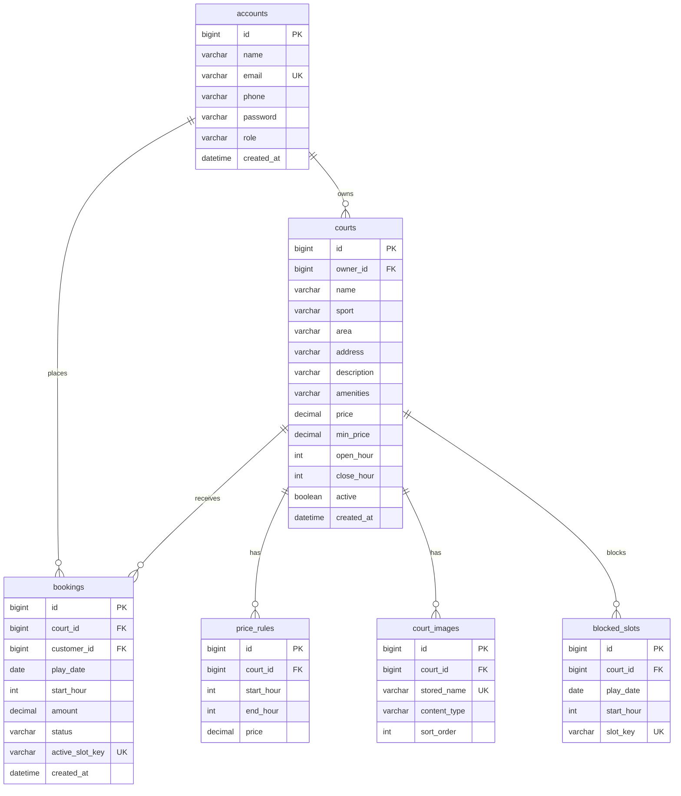

# Thiết kế cơ sở dữ liệu và trạng thái đơn

Múi giờ nghiệp vụ: **Asia/Ho_Chi_Minh**. Schema do **Flyway** quản lý: `src/main/resources/db/migration/V1__init.sql`.

Profile `mysql`: `ddl-auto=validate`, Flyway bật.<br>
Profile `demo`: H2 trong bộ nhớ, `ddl-auto=create-drop`, Flyway tắt — **chỉ minh họa**, mất dữ liệu khi tắt app.

## Sơ đồ quan hệ (ERD)



## Chỉ mục và chống trùng

- `accounts.email` unique.
- `courts(active, sport, area)`, `courts(owner_id)`, `courts(min_price)`.
- `bookings(customer_id, created_at)`, `(court_id, play_date)`, `(status, play_date)`.
- `bookings.active_slot_key` **unique nullable**: đơn đang giữ giờ có khóa `courtId:date:hour`. Hủy đặt `NULL` (MySQL cho nhiều NULL).
- `blocked_slots.slot_key` unique cùng định dạng khóa.
- Đặt sân: transaction `READ_COMMITTED` + `SELECT ... FOR UPDATE` trên hàng `courts` + unique key. Hai request cùng khung: một thành công, một lỗi ràng buộc/nghiệp vụ.

## Giá

- `courts.price`: giá mặc định mỗi khung 60 phút.
- `price_rules`: khoảng `[start_hour, end_hour)` đè giá mặc định.
- `courts.min_price`: giá thấp nhất (lọc danh sách), cập nhật khi lưu sân.
- `bookings.amount`: **ảnh giá lúc đặt**. Đổi bảng giá không sửa đơn cũ.

## Ảnh

- File lưu ngoài DB: `{UPLOAD_DIR}/courts/{courtId}/{uuid}.jpg|png|webp`.
- Tên tệp chỉ UUID; không dùng tên gốc; không phục vụ như script.
- Giới hạn 2 MB/ảnh, tối đa 8 ảnh/sân; kiểm tra magic bytes JPEG/PNG/WEBP.

## Máy trạng thái đơn

```text
(đặt thành công) --> CONFIRMED
CONFIRMED --> CANCELLED   khách: trước giờ bắt đầu > 2 giờ
CONFIRMED --> CANCELLED   chủ sân: trước giờ bắt đầu
CONFIRMED --> COMPLETED   sau giờ kết thúc khung + chủ xác nhận đã thu
CANCELLED, COMPLETED: kết thúc, không hoàn tác trên UI
```

Doanh thu = tổng `amount` các đơn `COMPLETED` theo `play_date` trong khoảng lọc, nhóm theo sân của **chủ đang đăng nhập**.
